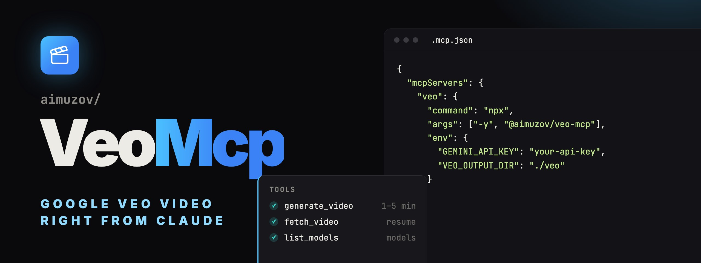

<p align="center">
	
	<a href="README.ru.md"></a>
</p>

<p align="center">
	
</p>

<p align="center">
	<a href="https://github.com/aimuzov/veo-mcp/actions/workflows/check.yml"></a>
	<a href="https://github.com/aimuzov/veo-mcp/releases"></a>
	<a href="package.json"></a>
	<a href="https://modelcontextprotocol.io"></a>
	<a href="LICENSE"></a>
</p>

<h3 align="center">Google Veo as an MCP tool</h3>
<p align="center">Text-to-video and image-to-video through the Gemini API, MP4 files on disk</p>

An MCP server that gives Claude Code, Claude Desktop or any other MCP client video generation with Google Veo. It talks to the Gemini API directly: text-to-video, image-to-video and a transition between a first and a last frame. The MP4 is saved on the machine that runs the server.

## Tools

- `generate_video` starts a render, waits for it and saves the MP4. Takes a `prompt` and, optionally:
    - `image`, the first frame (png, jpg, webp), and `lastFrame`, which needs `image`;
    - `negativePrompt`, `seed`;
    - `aspectRatio`: `16:9` (default) or `9:16`;
    - `durationSeconds`: 4, 6 or 8 (default); `1080p` and `4k` need 8;
    - `resolution`: `720p` (default), `1080p` or `4k`;
    - `model` (`veo-3.1-generate-preview` by default), `filename`, `outputDir`.

    Returns the file path. While it waits, it sends MCP progress notifications, so the client doesn't time the call out.

- `fetch_video` waits for a render that is already running and saves it by its operation name. When `generate_video` fails after the render started, its error names the operation: `fetch_video` picks it up without paying twice.
- `list_models` lists the Veo models your key can use.

Veo is billed per second of video and a render takes one to five minutes, so the tool asks the model to check before generating several variants. Network errors, 429 and 5xx are retried with backoff. When the safety filter drops a video, the error says why.

## Setup

Node 26 or newer. Add the server to your MCP config, see [.mcp.json.example](.mcp.json.example):

```json
{
	"mcpServers": {
		"veo": {
			"command": "npx",
			"args": ["-y", "@aimuzov/veo-mcp"],
			"env": { "GEMINI_API_KEY": "your-api-key", "VEO_OUTPUT_DIR": "./veo" }
		}
	}
}
```

Get a key at [AI Studio](https://aistudio.google.com/apikey), Veo needs a project with billing enabled. Without a key the server still starts, and every tool answers with that hint.

The server runs only over stdio: a video is a file on the disk of the machine that made it, a hosted connector would leave it on someone else's server.

| Variable               | Default  | What it does                       |
| ---------------------- | -------- | ---------------------------------- |
| `GEMINI_API_KEY`       |          | Gemini API key, required           |
| `VEO_OUTPUT_DIR`       | `./veo`  | Where videos are saved             |
| `VEO_POLL_INTERVAL_MS` | `10000`  | How often to poll the render       |
| `VEO_TIMEOUT_MS`       | `900000` | When to give up on a render        |
| `LOG_LEVEL`            | `info`   | `error`, `warn`, `info` or `debug` |

## Development

```bash
npm install
npm start          # the TypeScript sources over stdio, no build
npm test
npm run lint
npm run typecheck
npm run build      # build/ for the npm package
```

Shared helpers and the CI steps come from [infra-mcp-kit](https://github.com/aimuzov/infra-mcp-kit), formatting and lint rules from [infra-site-kit](https://github.com/aimuzov/infra-site-kit).

## License

[MIT](LICENSE)
