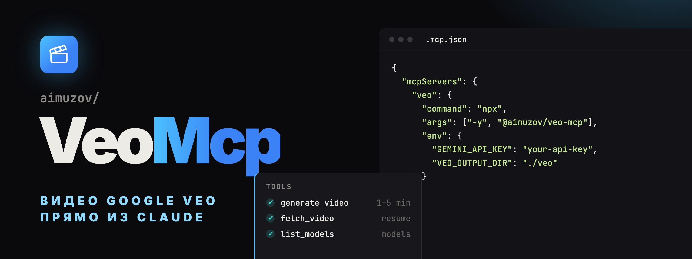

<p align="center">
	<a href="README.md"></a>
	
</p>

<p align="center">
	
</p>

<p align="center">
	<a href="https://github.com/aimuzov/veo-mcp/actions/workflows/check.yml"></a>
	<a href="https://github.com/aimuzov/veo-mcp/releases"></a>
	<a href="package.json"></a>
	<a href="https://modelcontextprotocol.io"></a>
	<a href="LICENSE"></a>
</p>

<h3 align="center">Google Veo как инструмент MCP</h3>
<p align="center">Видео по тексту и по картинке через Gemini API, MP4 на диске</p>

MCP-сервер, который даёт Claude Code, Claude Desktop и любому другому MCP-клиенту генерацию видео через Google Veo. Ходит в Gemini API напрямую: видео по тексту, по картинке и переход между первым и последним кадром. MP4 сохраняется на машине, где запущен сервер.

## Инструменты

- `generate_video` запускает рендер, ждёт его и сохраняет MP4. Принимает `prompt` и, по желанию:
    - `image`, первый кадр (png, jpg, webp), и `lastFrame`, который требует `image`;
    - `negativePrompt`, `seed`;
    - `aspectRatio`: `16:9` (по умолчанию) или `9:16`;
    - `durationSeconds`: 4, 6 или 8 (по умолчанию); для `1080p` и `4k` нужно 8;
    - `resolution`: `720p` (по умолчанию), `1080p` или `4k`;
    - `model` (по умолчанию `veo-3.1-generate-preview`), `filename`, `outputDir`.

    Возвращает путь к файлу. Пока ждёт, шлёт MCP-уведомления о прогрессе, чтобы клиент не оборвал вызов по таймауту.

- `fetch_video` дожидается уже идущего рендера и сохраняет его по имени операции. Если `generate_video` упал после старта рендера, в его ошибке есть имя операции: `fetch_video` докачает видео без второй оплаты.
- `list_models` показывает модели Veo, доступные твоему ключу.

Veo тарифицируется посекундно, а рендер идёт от одной до пяти минут, поэтому инструмент просит модель уточнить, прежде чем генерировать несколько вариантов. Сетевые ошибки, 429 и 5xx повторяются с паузой. Если видео отсеял фильтр безопасности, в ошибке будет причина.

## Установка

Нужен Node 26 или новее. Добавь сервер в конфиг MCP, см. [.mcp.json.example](.mcp.json.example):

```json
{
	"mcpServers": {
		"veo": {
			"command": "npx",
			"args": ["-y", "@aimuzov/veo-mcp"],
			"env": { "GEMINI_API_KEY": "your-api-key", "VEO_OUTPUT_DIR": "./veo" }
		}
	}
}
```

Ключ берётся в [AI Studio](https://aistudio.google.com/apikey), для Veo у проекта должен быть включён биллинг. Без ключа сервер всё равно стартует, а каждый инструмент отвечает этой подсказкой.

Сервер работает только по stdio: видео — это файл на диске машины, которая его сделала, а размещённый коннектор оставил бы его на чужом сервере.

| Переменная             | По умолчанию | Что делает                          |
| ---------------------- | ------------ | ----------------------------------- |
| `GEMINI_API_KEY`       |              | Ключ Gemini API, обязателен         |
| `VEO_OUTPUT_DIR`       | `./veo`      | Куда сохранять видео                |
| `VEO_POLL_INTERVAL_MS` | `10000`      | Как часто опрашивать рендер         |
| `VEO_TIMEOUT_MS`       | `900000`     | Когда перестать ждать рендер        |
| `LOG_LEVEL`            | `info`       | `error`, `warn`, `info` или `debug` |

## Разработка

```bash
npm install
npm start          # исходники TypeScript по stdio, без сборки
npm test
npm run lint
npm run typecheck
npm run build      # build/ для npm-пакета
```

Общие хелперы и шаги CI берутся из [infra-mcp-kit](https://github.com/aimuzov/infra-mcp-kit), правила форматирования и линтера — из [infra-site-kit](https://github.com/aimuzov/infra-site-kit).

## Лицензия

[MIT](LICENSE)
